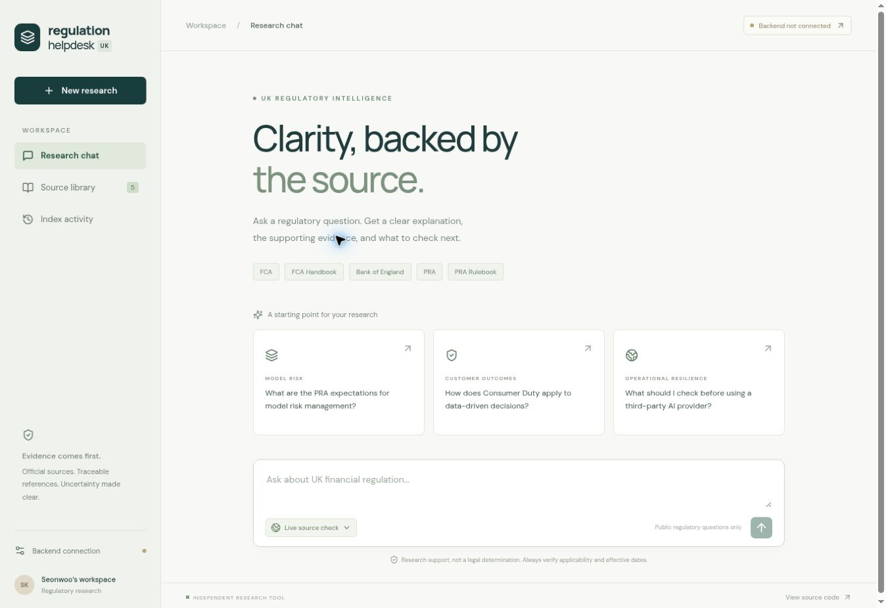

# UK Regulation Helpdesk

An evidence-led research chatbot for UK banking and data science. One repository contains a **Python/FastAPI backend** and a **React/JavaScript frontend** for GitHub Pages.

Ask across FCA publications, the FCA Handbook, Bank of England publications, PRA publications and the PRA Rulebook. Answers include source titles, sections, URLs, retrieved passages and check timestamps. If a supported answer cannot be established, the interface shows references and uncertainty instead.

[Open the website](https://swk99.github.io/data-regulation-helpdesk-uk/) · [Validation record](docs/validation.md)



## Application status

- Frontend: GitHub Pages deployment workflow included.
- Backend: implemented, **not deployed**. Connect its HTTPS URL and access token in the website.
- Corpus: not bundled or redistributed. It is built on the backend host from permitted public documents.
- Live mode: bounded discovery and relevant-source revalidation, **not an exhaustive real-time search of every regulator page**.
- FCA general publications: indexing is permission-gated under FCA legal terms 3.3; direct source links remain available.
- FCA Handbook: its public landing page requires JavaScript. The adapter reports this limitation rather than indexing an empty shell. See source verification notes.
- Generated summaries require Ollama with the configured chat model. Without Ollama, indexed keyword search and evidence excerpts remain available.

## Features

- Persistent ChromaDB vectors with explicit Ollama embeddings; SQLite FTS5 keyword retrieval.
- Official HTTPS host allowlist, redirect validation, robots.txt checks, bounded downloads, rate limiting and retries.
- HTML/PDF parsing, headings, page numbers, publication metadata when exposed, and numbered-reference extraction.
- Immutable raw snapshots and version hashes; idempotent updates and active-version filtering.
- Rule/guidance markers and publication-type labels; no assumption that publication date equals effective date.
- A bounded research agent: retrieve → optionally discover/recheck → retrieve again → summarize → validate citations.
- Exact-quote and citation validation, plus references-only fallback. This does not prove semantic correctness; inspect source passages.
- Authenticated backend APIs, origin-restricted CORS, in-memory browser token, no question logging or chat persistence.
- Built-in six-hour update loop while the backend runs; CLI for external schedulers.

## Quick start for development

Python 3.11+ and Node.js 22+ are required. Production hosting instructions are in [docs/deployment.md](docs/deployment.md). These commands are for developers; visitors to GitHub Pages do not need Python.

```bash
python -m venv .venv
# Activate .venv for your platform
pip install -r backend/requirements-dev.txt
cd backend
# Set API_TOKEN, OLLAMA_URL and other environment variables (see .env.example).
ollama pull nomic-embed-text
ollama pull qwen2.5:14b
uvicorn reghelp.api:app --host 127.0.0.1 --port 8000 --workers 1
```

In a second terminal:

```bash
cd frontend
npm ci
npm run dev
```

Open the frontend, choose **Backend connection**, and enter the backend URL and API_TOKEN. Select **Index activity → Check for updates**, or ask a question with **Live source check** enabled.

For PowerShell environment setup:

```powershell
$env:API_TOKEN = python -c "import secrets; print(secrets.token_urlsafe(32))"
$env:OLLAMA_URL = 'http://127.0.0.1:11434'
# Display the token only in your own terminal when you need to enter it in the frontend.
```

The application reads process environment variables; it does not automatically load `.env` files.

## CLI

Run from `backend/` with the virtual environment active:

```bash
python -m reghelp.cli update
python -m reghelp.cli ask "What are the PRA expectations for model risk management?" --live
python -m reghelp.cli status
```

Run one backend process. Do not run CLI writes concurrently with that server against the same data directory. The in-process scheduler and live checks share an ingestion lock.

## Tests

```bash
# Repository root; PowerShell: $env:PYTHONPATH='backend'
PYTHONPATH=backend python -m pytest backend/tests -q
npm test --prefix frontend
npm run build --prefix frontend
```

[Architecture](docs/architecture.md) · [Deployment](docs/deployment.md) · [Source verification and limits](docs/source-verification.md)

This is an independent research tool, not affiliated with any regulator. Public availability does not imply unrestricted reuse. Keep fetched content private to the permitted research use; review source terms before broader deployment. Never enter customer data, confidential bank information or credentials in chat.
