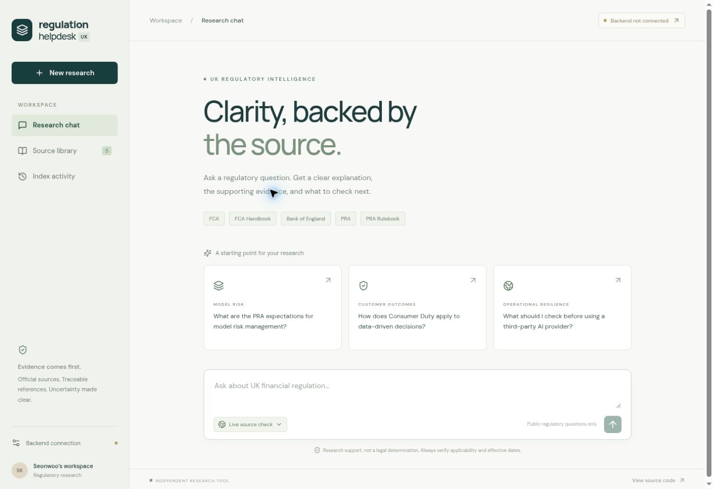

# Validation record

3 November 2026

- 19 backend tests passed locally, and in GitHub Actions on Python 3.11 and 3.12.
- Two frontend tests passed; the production Vite build passed locally and in Actions.
- Browser checks verified rendering, suggested-question population and the disconnected-backend connection dialog.
- GitHub Pages publication succeeded after enabling the repository's Pages source as GitHub Actions. The deployed URL was opened and verified.
- Both BoE feeds, the PRA banking policy index and the PRA CRR Rulebook directory were fetched with the application fetcher.
- A live PRA publication (SS2/26 – High loan to income lending) was successfully parsed, indexed and retrieved by keyword search in a temporary test corpus. Its type was correctly identified as a supervisory statement. The temporary test intentionally used no model.
- End-to-end model tests use a deterministic mocked Ollama response. Real Ollama generation and embedding quality have **not** been evaluated on a representative legal benchmark. No production backend or model service was deployed.
- General FCA publication indexing remains permission-gated. FCA Handbook access remains unavailable pending a verified permitted API/rendering integration. These are coverage limits, not passing source integrations.

Code tests: https://github.com/swk99/data-regulation-helpdesk-uk/actions/runs/41622409745

Pages deployment: https://github.com/swk99/data-regulation-helpdesk-uk/actions/runs/41622409873

